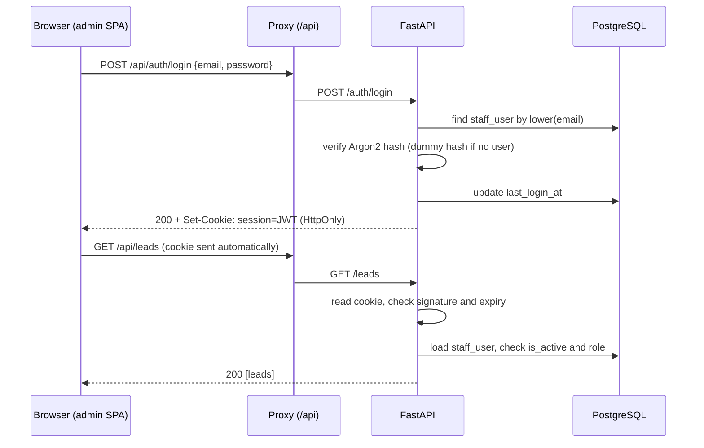

# Admin panel and staff authentication

A separate single-page app (Vite + React) for the shop staff. It lists the leads that come
from the custom-order form and lets staff change their status. This document records the
decisions; [`plan.md`](plan.md) has the step-by-step checklist.

## Goals

- Staff can log in, see leads, open one lead, and change its status.
- The public shop (`frontend/`, Next.js) stays as it is. The admin app is a second client of
  the same FastAPI backend.
- Learning goals: password hashing, sessions with cookies, role checks, pagination, a
  client-side router, TanStack Query, and tests on every level.

## Non-goals (for now)

- Customer accounts and public registration. `customer` has no password in the schema, and
  customers are identified by phone number. See "Customers" below.
- Refresh tokens, password reset by email, two-factor authentication.
- Orders, payments and the portfolio in the admin panel. Leads only.

## What already exists

- Table `staff_user` (`email`, `password_hash`, `name`, `role`, `is_active`, `last_login_at`)
  in `docs/db/schema.sql`, the model `StaffUserModel`, the initial migration, and the domain
  class `StaffUser` with `StaffRole` (`admin`, `baker`).
- Table `lead` with statuses `new`, `in_progress`, `converted`, `rejected`, the `LeadStatus`
  enum, `POST /leads` (public), `LeadRepository`, and the `UnitOfWork` pattern.

So authentication needs **no new table**. The first migration, if any, is only for fields we
may add later.

## Decisions

| # | Decision | Why | Alternative we did not choose |
|---|----------|-----|-------------------------------|
| 1 | Staff are stored in `staff_user`. Roles: `admin` (everything) and `baker` (leads: read and change status). | The table and the model are already designed. | One `users` table with a `customer` role. |
| 2 | Passwords are hashed with Argon2 (`pwdlib[argon2]`). Hashing is behind a `PasswordHasher` Protocol. | Argon2 is the modern default, and a Protocol lets use-case tests use a fast fake. | bcrypt; storing anything reversible. |
| 3 | Session = a signed JWT (`PyJWT`) in an `HttpOnly` cookie named `session`. Lifetime 1 hour. No refresh token in version 1. | JavaScript cannot read the cookie, so XSS cannot steal the token. Simple to build and to test. | Token in `localStorage`; refresh tokens stored in the database. |
| 4 | On every request the backend loads the staff user from the database and checks `is_active`. | A disabled account stops working at once, not when the token expires. | Trusting the role inside the token. |
| 5 | The SPA and the API share one origin: the Vite dev server (and Caddy in production) proxy `/api` to FastAPI and remove the prefix. | The cookie is first-party, and there is no CORS to configure. | Different origins with `credentials: "include"` and CORS. |
| 6 | Cookie flags: `HttpOnly`, `SameSite=Lax`, `Secure` outside development, `Path=/`. | Protects against cross-site requests. | `SameSite=None`. |
| 7 | CSRF: state-changing endpoints accept only `application/json` bodies, and CORS stays closed for them (as now: only `GET` is allowed). | A cross-site HTML form cannot send JSON, and a cross-origin `fetch` with JSON needs a CORS preflight that we refuse. | A CSRF token. We revisit this if we ever allow other origins. |
| 8 | The first admin is created by a command (`create-admin`), never through a public endpoint. More staff are created by an admin through `POST /staff`. | There is no way to register yourself as staff. | A public sign-up with manual approval. |
| 9 | Staff passwords: 12 to 128 characters. | There are few accounts, so a longer minimum is cheap. | 8 characters. |
| 10 | `login` gives the same error and does the same amount of work for "unknown email" and "wrong password". | Prevents finding out which emails exist, by message or by timing. | Specific messages. |

## Customers (decision postponed)

`customer` is created from leads and orders and has no password. If we want customer
accounts later, the options are: add `password_hash` to `customer`, or log in by a one-time
code sent to the phone. Neither is part of this work. The shop already works without
customer accounts.

## Authentication flow

## API contract

| Method and path | Who | Description | Errors |
|---|---|---|---|
| `POST /auth/login` | public | Body `{email, password}`. Sets the `session` cookie. Returns the staff user (no hash). | 401 `Invalid email or password`; 422 bad body |
| `POST /auth/logout` | any staff | Clears the cookie. | none |
| `GET /auth/me` | any staff | Current staff user. The SPA calls it on start. | 401 |
| `GET /leads` | admin, baker | Query: `limit` (1 to 100, default 20), `offset`, `status`. Newest first. Returns `{items, total}`. | 401, 422 |
| `GET /leads/{id}` | admin, baker | One lead. | 401, 404 |
| `PATCH /leads/{id}` | admin, baker | Body `{status}`. Only allowed transitions. | 401, 404, 409 transition not allowed, 422 |
| `POST /staff` | admin | Create a staff user. | 401, 403, 409 email exists, 422 |
| `POST /leads` | public | Already exists. Stays public. | |

401 means "not logged in or session expired". 403 means "logged in, but the role is not
enough". Validation errors keep the FastAPI 422 format that the shop already uses.

### Lead status transitions

`new` to `in_progress` or `rejected`; `in_progress` to `rejected`. The status `converted`
is set only by the future "create an order from a lead" feature, which also fills
`converted_order_id`, so `PATCH` refuses it for now. The rules live in the domain (a method on
`Lead`), not in the router.

## Security checklist

- [ ] Passwords and tokens are never logged. Lead phone numbers and emails are not logged either.
- [ ] Same response and similar time for unknown email and wrong password.
- [ ] Rate limit on `POST /auth/login` (by IP and by email).
- [ ] The cookie is `HttpOnly`, `SameSite=Lax`, `Secure` in production.
- [ ] `JWT_SECRET` comes from the environment, has at least 32 random bytes, and is never in
      the repository or in `.env.example` with a real value.
- [ ] A disabled user (`is_active = false`) cannot use an old cookie.
- [ ] A tampered or expired token returns 401, never 500.
- [ ] Error messages do not reveal whether a user exists.

## Testing strategy

- **Unit (no database):** use cases with a fake repository and fake hasher and token service.
- **Repository (real database):** `StaffRepository`, with the savepoint fixture you already have.
- **API:** wrong password, unknown email, disabled user, expired and tampered token,
  baker on an admin-only route (403), missing cookie (401), pagination and filters.
- **Admin app:** Vitest for small pure functions and components.
- **End to end:** Playwright in `admin/e2e/` for login, wrong password, change a status,
  logout, and a redirect when logged out.

## Open questions

- Which language does the admin interface use? (Suggestion: Russian only to start.)
- Do bakers need to see phone numbers, or only the lead details?
- Should an inactive session show a "session expired" message or just open the login page?
