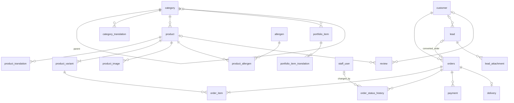

# Схема БД

Файл [`schema.sql`](schema.sql) можно прогнать на пустой БД: `psql -f docs/db/schema.sql`.
Боевая схема будет жить в моделях SQLAlchemy + миграциях Alembic, а этот файл — проект для ревью.

## Что изменено относительно первого черновика

**Ошибки**
- `order_detail.order_id` / `product_id` были nullable — теперь `NOT NULL`.
- `timestamp` → `timestamptz` везде.
- На `code` в справочниках не было `UNIQUE`; сами справочники заменены (см. ниже).
- Не было `CHECK`: `quantity > 0`, цены `>= 0`, рейтинг 1–5, формат телефона E.164, `paid` ⇒ есть `paid_at`.
- Не было индексов на внешние ключи (Postgres их не создаёт сам).
- `email varchar(50)` → `varchar(255)`, уникальность без учёта регистра (`lower(email)`).
- `price`/`amount`: `numeric(9,2)` → `numeric(10,2)`.

**Решения**
- **Статусы, способы оплаты, типы доставки — не таблицы, а `varchar + CHECK` + `StrEnum` в Python.**
  Это не данные, а часть логики (переходы статусов в коде), поэтому JOIN-ы, сиды и id в
  домене не нужны. Названия для интерфейса берутся из переводов фронтенда по коду.
- `order_detail` → `order_item`; `lead_status_id` → `status`.
- `orders.amount` → `total_amount` (позиции + доставка), считается в одном месте: `Order.calculate_total`.
- `delivery.delivery_at` убрано: время для всех заказов в `orders.desired_at`.
- `lead.reference_url` заменён таблицей `lead_attachment` (несколько картинок-референсов).

**Добавлено**
- `orders.desired_at` — к какому времени нужен заказ (самое важное поле для кондитерской).
- `orders.public_id` (uuid) — ссылка «отследить заказ», нельзя перебрать как `id`.
- `product_variant` — размеры торта; **цена теперь у варианта**, а не у товара.
- `*_translation` — названия и описания товаров, категорий и работ портфолио на `ru` / `en` / `fr`; таблица `locale`.
  Названия аллергенов и статусов в БД не хранятся: их переводит фронтенд по коду.
- `product_image`, `slug`, `sort_order` — несколько фото, ЧПУ-ссылки, ручная сортировка.
- `allergen` + `product_allergen`, `portfolio_item`, `review` (с модерацией).
- `staff_user` (админка) и `order_status_history.changed_by` / `comment`.
- `order_item.product_name` / `variant_label` / `comment` — снимок названия и надпись на торте.
- `payment.external_id` + частичный уникальный индекс — защита от повторной обработки вебхука.
- `orders.currency` — валюта заказа (ISO 4217), одна на магазин, из настроек; суммы позиций,
  доставки и платежей заказа считаются в ней. Захардкоженной валюты в схеме и коде нет.
- `lead.desired_date` / `servings` / `budget`.

## Что осознанно НЕ входит (пока)
- `promotion` / промокоды — после MVP.
- `ingredient` / `recipe` — это учёт склада и себестоимости, а не витрина.
- Корзина в БД — на старте достаточно хранить её на клиенте.
- Триггеры `updated_at` — выставляем из ORM (`onupdate=func.now()`).
- Расписание работы, зоны и стоимость доставки, лимит заказов на день.

## Инварианты, которые проверяет приложение (БД их не выразит)
- У активного товара есть хотя бы один активный вариант.
- У заказа с `delivery_type = 'delivery'` есть строка в `delivery`; у самовывоза — нет.
- `orders.total_amount` = сумма `quantity * price_at_order` + `delivery.cost`.
- При создании заказа и каждой смене статуса пишется строка в `order_status_history`.
- Допустимые переходы статусов: `Order.allowed_next_statuses()`.
